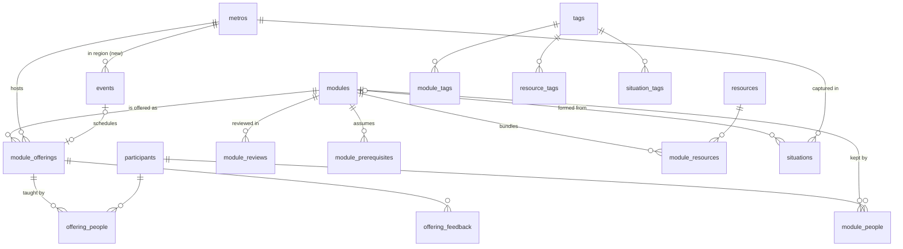

# Module catalog and knowledge base: schema draft

Draft of Nov 19, 2026, for Scaffolding and Front Door to work through together. Everything here is a proposal. Existing OLOS tables are a starting point and can change where the catalog needs them to.

## What this draws on

- The PRD "A Bottom-Up Module Catalog for The Upskilling Labs" (Nov 14) and the steering committee member's notes in it.
- This prototype's module metadata (`modules/_template.md`) and situation logs (`situations/_template.md`).
- Front Door's scoping of who owns what: National, Regional (one record can belong to many regions), or Both ([`participants-scoping.md`](https://github.com/wash-TheUpskillingLabs/c04-frontdoor/blob/main/research/participant-scope/participants-scoping.md)).
- Front Door's [`participants` data dictionary](https://github.com/wash-TheUpskillingLabs/c04-frontdoor/blob/main/research/participant-scope/participants-data-dictionary.md) and the OLOS schema diagrams in [`research/olos-schema/`](https://github.com/wash-TheUpskillingLabs/c04-frontdoor/tree/main/research/olos-schema) (OLOS at `ca543cc`).
- Front Door's [dimensions mind map](https://github.com/wash-TheUpskillingLabs/c04-frontdoor/blob/main/research/Upskilling_Labs_dimensions_mindmap_rough-draft.pdf) (rough draft): its names for activities, participant roles, knowledge capture and location are used below.

## How National, Regional and Both apply

A region is an OLOS `metros` row (a local lab). Regional means linked to one or more metros.

| Record | Scope | Why |
|---|---|---|
| Module | National | The catalog is national. A module is written once and can be used anywhere. Where it came from is recorded, but doesn't limit where it's used. |
| Offering (a workshop or in-person training of a module) | Both | It belongs to a national module and happens in a region. It shows in the national catalog ("offered in Greater Washington and Baltimore") and on each lab's own page. A virtual offering has no region and shows everywhere. |
| Resource (blog post, guide, recording, slide deck) | National by default; Regional when it's about one place | Most content is general. A venue guide or a local partner's page belongs to one lab. |
| Situation log | Regional when captured | It happens in a lab, in a cycle, often in one pod. Whether others can see it is a separate setting (see `situations`). |
| Tag | National | The taxonomy is shared by all labs and by the three pods. |
| A person's role on a module or offering | Follows the record | A maintainer of a national module is a national role. A teacher of an offering is a regional one. |

## The tables

`participants`, `metros`, `events`, `cycles` and `resources` already exist in OLOS. The rest are new.

### `modules` (National)

One row per module. The Markdown file in Git stays the source of the content; the row holds its metadata and points at the file. The Must and Should labels are the PRD's.

| Column | Type | Must or Should | Notes |
|---|---|---|---|
| `id` | serial | | |
| `slug` | varchar(100), unique | Must | Same as the Markdown file name |
| `title` | varchar(255) | Must | |
| `summary` | text | Must | One sentence, shown on the card |
| `kind` | text: `upskilling`, `training` | Must | Training modules are for the people who deliver modules |
| `status` | text: `draft`, `stable`, `retired` | Must | `stable` needs an approved review of the current version |
| `output_type` | text: `training`, `workshop` | Must | Training has no required output; a workshop does |
| `output` | text | Must | What people leave with |
| `learning_outcome` | text | Must | What the learner can do afterward. Written first; the exercises are worked back from it |
| `stages` | text[]: `prep`, `during`, `after` | Must | Before, during, or after a cycle |
| `scales` | text[]: `1:1`, `1:few`, `1:cohort/public` | Must | |
| `delivered_by_role` | text | Must | The role that usually runs it, never a name. Who actually teaches an offering is in `offering_people` |
| `timings` | text[]: `before-attempt`, `when-stuck`, `after` | Should | |
| `learner_stages` | text[]: `dependent`, `interested`, `involved`, `self-directed` | Should | |
| `ai_levels` | `ai_experience_level`[] | Should | Reuses the participant enum (`new`, `consumer`, `builder`, `shipper`), so a module and a person can be matched. Front Door's dictionary says nothing sets the participant column yet |
| `support_fades` | text | Should | What gets withdrawn, and when |
| `time_estimate` | text | Should | "60 minutes" |
| `private_way_in` | text | Must if `before-attempt` is in `timings` | Planned struggle can read as public failure (#5) |
| `way_out` | text | Must if `before-attempt` is in `timings` | |
| `validated_note` | text | | For the small top-down core, such as GitHub training: "validated as needed to join the ecosystem." A sentence, not a flag, so nothing reads as "required" |
| `cycle_id` | integer → `cycles`, nullable | | Set for a cohort-specific module, such as team setup for C04 |
| `origin_metro_id` | integer → `metros`, nullable | | The lab where it was first made. Doesn't limit where it's offered |
| `contributed_by_org` | text, nullable | | An anonymized label for an outside contributor, such as "a small business in logistics." Not a link to an organization |
| `thumbnail_url` | text | Should | The card's Open Graph image |
| `source_path` | text | | The Markdown file's path in Git |
| `source_sha` | varchar(40) | | The commit the row was last synced from. Reviews refer to it |
| `created_at`, `updated_at`, `published_at` | timestamptz | | |

Nothing marks a module as required or graded. The catalog has no completions, scores or credentials (PRD non-goals).

### `module_people` (National)

Who keeps a module. Roles use the mind map's participant roles.

| Column | Type | Notes |
|---|---|---|
| `module_id` | integer → `modules` | |
| `participant_id` | integer → `participants` | |
| `role` | text: `maintainer`, `author`, `reviewer`, `contributor` | |
| `since`, `until` | timestamptz | `until` set when someone steps back |

Rule: a module needs at least two current maintainers.

Public pages show roles ("a C04 maintainer"). Showing a name would depend on the person's profile settings (`public_profile_visible` in Front Door's dictionary).

### `module_reviews` (National)

A review of the learning material itself, before it is used. Workshops currently rely on outside experts with no quality check (steering committee interview, #25).

| Column | Type | Notes |
|---|---|---|
| `id` | serial | |
| `module_id` | integer → `modules` | |
| `reviewer_participant_id` | integer → `participants` | |
| `source_sha` | varchar(40) | The version that was reviewed |
| `outcome` | text: `approved`, `changes_requested` | |
| `notes` | text | What was checked. What a review checks, and how often, is still open |
| `reviewed_at` | timestamptz | |

### `module_prerequisites` (National)

What a module assumes. Either another module, or a skill or tool that has no module yet ("Git, Vercel and Supabase" for rapid prototyping).

| Column | Type | Notes |
|---|---|---|
| `module_id` | integer → `modules` | |
| `requires_module_id` | integer → `modules`, nullable | |
| `requires_tag_id` | integer → `tags`, nullable | A skill or tool tag. One of the two is set |

### `module_offerings` (Both)

A module delivered somewhere: a workshop, an in-person training, a talk. One module has many offerings, in one or more labs.

| Column | Type | Notes |
|---|---|---|
| `id` | serial | |
| `module_id` | integer → `modules` | |
| `metro_id` | integer → `metros`, nullable | Empty means virtual, shown in every lab |
| `event_id` | integer → `events`, nullable | Set once it's scheduled. Date, place and RSVPs come from the event |
| `format` | text: `in-person`, `virtual`, `hybrid` | |
| `status` | text: `proposed`, `scheduled`, `held`, `cancelled` | |
| `host_org` | text, nullable | An outside host, if it isn't the Labs. What approval an outside host needs is open |
| `created_at`, `updated_at` | timestamptz | |

The national catalog lists each module with its offerings' labs. A lab's page lists offerings with its `metro_id`, plus virtual ones.

### `offering_people` (Both)

| Column | Type | Notes |
|---|---|---|
| `offering_id` | integer → `module_offerings` | |
| `participant_id` | integer → `participants` | |
| `role` | text: `teacher`, `co-teacher`, `host`, `mentor` | The mind map's "Teacher" |

### `offering_feedback` (Both)

Feedback on the workshop, not on the learner. Steering committee notes: hosting a workshop with feedback should be easy enough for an outside host.

| Column | Type | Notes |
|---|---|---|
| `id` | serial | |
| `offering_id` | integer → `module_offerings` | |
| `participant_id` | integer → `participants`, nullable | Empty for anonymous feedback |
| `useful` | smallint 1 to 5 | |
| `comment` | text | |
| `created_at` | timestamptz | |

### `resources` (existing; National by default)

OLOS already has a Library table, `resources`, with `slug`, `title`, `content_type`, `summary`, `tags` (jsonb), `status`, `author`, `url`, `license` and `body`. A module is a bundle of content, so its resources live here, and the knowledge base is this table too.

Proposed changes:
- `content_type` values to include the PRD's kinds: `blog-post`, `guide`, `facilitation`, `recording`, `slide-deck`.
- `audience`: `learner` or `facilitator`.
- `metro_ids` or a `resource_metros` join, for the few resources that belong to one or more labs. Empty means national.
- Move `tags` from jsonb to `resource_tags`, so the same taxonomy counts across resources, modules and situations.

### `module_resources` (National)

| Column | Type | Notes |
|---|---|---|
| `module_id` | integer → `modules` | |
| `resource_id` | integer → `resources` | |
| `purpose` | text: `learner`, `facilitator` | |
| `position` | smallint | Order on the module page |

### `situations` (Regional when captured)

The light, bottom-up capture: what the problem was and what worked. The mind map's "Knowledge capture & Reuse" names its sources: learning sessions, cohorts and events.

| Column | Type | Notes |
|---|---|---|
| `id` | serial | |
| `problem` | text | A few lines |
| `what_worked` | text | A few lines. "Nothing did" is allowed |
| `logged_by_participant_id` | integer → `participants` | Never shown outside the lab |
| `logged_by_role` | text | What others see: "a mentor," "a Poderator" |
| `scale` | text: `1:1`, `1:few`, `1:cohort/public` | |
| `source` | text: `learning-session`, `cohort`, `event`, `escalation`, `front-door` | `escalation`: a team escalated and a mentor accepted (OLOS). `front-door`: someone brought a specific problem to Front Door |
| `metro_id` | integer → `metros` | |
| `cycle_id` | integer → `cycles`, nullable | |
| `module_id` | integer → `modules`, nullable | Set when a module forms from it, or when it fits an existing one |
| `visibility` | text: `lab`, `national` | Default `lab`. `national` only after names, organizations and identifying details are taken out |
| `created_at` | timestamptz | |

### `tags` and the joins (National)

Tags grow from use, with a small set from the top. One table for all of them, so the same tag counts on modules, resources and situations, and later on participants' interests.

| Column | Type | Notes |
|---|---|---|
| `id` | serial | |
| `slug` | varchar(50), unique | |
| `label` | text | |
| `kind` | text: `topic`, `tool`, `skill`, `practice` | `practice` holds the crosswalk terms (Record #20) |
| `framework` | text, nullable | For `practice`: `dorst`, `double-diamond`, `ideo`, `agile`, `lean-startup`. Replaces the prototype's free-text `maps_to` |
| `status` | text: `emerging`, `term`, `set-from-top` | A new tag is `emerging`. Someone promotes it to a `term`. Who decides is open |
| `created_at` | timestamptz | |

Joins: `module_tags`, `resource_tags`, `situation_tags`, each a pair of IDs.

## How people connect

People take part in modules, offerings and the knowledge base through links to `participants`, not by copying details into these tables.

| A person… | Through |
|---|---|
| keeps or reviews a module | `module_people`, `module_reviews` |
| teaches or hosts an offering | `offering_people` |
| attends an offering | the existing `event_rsvps`, through `module_offerings.event_id` |
| saves a module or resource | the existing `saved_items` (keyed by slug) |
| logs a situation | `situations.logged_by_participant_id` |
| gives feedback on a workshop | `offering_feedback` |
| sees local offerings | their `metro_id` (Front Door's dictionary: the authoritative local lab) |
| could be matched to modules | their AI experience level against `modules.ai_levels`, and their interests against `tags` (below) |

Front Door has marked `interest_areas`, `primary_expertise` and `ai_tool_familiarity` as "New table." If those new tables use the same `tags`, the catalog can suggest modules from someone's interests and expertise, and a person's expertise can show who could teach or review a module. The mind map's "Interests" (experience, curiosity) and "Maturity" (outside, Labs, longitudinal) would fit there too.

`role_intents` (cycle, events, volunteer, mentor) could decide whether someone sees training modules by default.

## Changes this asks of OLOS

- **`events` has no region.** It has location fields but no link to `metros`. For offerings, and events in general, to show in the right labs, `events` needs a `metro_id`, or a join for an event shared by several labs. Front Door's scoping work is the natural place to decide that.
- **`resources.tags` is jsonb.** Moving it to `resource_tags` lets tags be counted and promoted across the catalog.
- **`resources` has no region or audience.** See the changes above.
- **`ai_experience_level` is defined but never set** (Front Door's dictionary). Modules can use it now. Matching people to modules needs the sign-up to ask it.
- **`saved_items` is keyed by slug.** Modules and resources need slugs that don't collide, or `saved_items` needs a type column.

## What changes from the prototype

- `maintained_by` and `reviewed_by` become links to people (`module_people`, `module_reviews`). Public pages still show roles.
- `delivered_by` becomes `delivered_by_role`, plus `offering_people` for who actually taught each offering.
- `maps_to` becomes `practice` tags tied to Record #20's crosswalk.
- `prerequisites` become links to modules or skill tags.
- `scope: general | cohort-specific` becomes `cycle_id`.
- New: offerings, region, origin lab, outside contributor, AI level, resources bundled with the module.
- The card stays a view: title, summary, thumbnail and a few metadata fields.

## Open questions

- [ ] Is "Both" its own value in Front Door's model, or a national row with regional links (as drafted here)?
- [ ] Can a lab keep a module for itself, or is every module national (as drafted)?
- [ ] Who can see a situation log by default: the lab, or only the person and their Poderator?
- [ ] What does a review check, how often, and does a changed file need a new review before it's `stable` again?
- [ ] What approval does an outside host need before an offering shows in the catalog?
- [ ] Who promotes an `emerging` tag to a `term`?
- [ ] Is the Markdown file or the database the source of truth? Drafted: the file, with the row synced by `slug` and `source_sha`.
- [ ] Should participants' interests and expertise use the same `tags` table? It would need Front Door's agreement.
