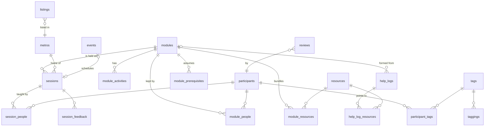

# Module catalog and knowledge base: schema draft

Draft of Nov 19, 2026, for Scaffolding and Front Door to work through together. Existing OLOS tables are a starting point and can change where the catalog needs them to.

Second pass, after the pod lead's decisions of Nov 19: federated data, regional modules proposed to national, module types, approval before publishing, the database as the source of truth, and one `tags` table shared with participants.

## What this draws on

- The PRD "A Bottom-Up Module Catalog for The Upskilling Labs" (Nov 14) and the steering committee member's notes in it.
- This prototype's module metadata (`modules/_template.md`) and situation logs (`situations/_template.md`), now called help logs.
- Front Door's scoping of who owns what, National, Regional or Both ([`participants-scoping.md`](https://github.com/wash-TheUpskillingLabs/c04-frontdoor/blob/main/research/participant-scope/participants-scoping.md)), its [`participants` data dictionary](https://github.com/wash-TheUpskillingLabs/c04-frontdoor/blob/main/research/participant-scope/participants-data-dictionary.md), and the OLOS schema diagrams in [`research/olos-schema/`](https://github.com/wash-TheUpskillingLabs/c04-frontdoor/tree/main/research/olos-schema) (OLOS at `ca543cc`).
- Front Door's [dimensions mind map](https://github.com/wash-TheUpskillingLabs/c04-frontdoor/blob/main/research/Upskilling_Labs_dimensions_mindmap_rough-draft.pdf) (rough draft): its names for activities, participant roles, knowledge capture and location.

## Decided (Nov 19)

- **Both means federated.** A record lives in one place, national or a region, and can also appear in others as a listing.
- **Content can live with one team only.** A team can keep a module, resource, session or Help Log to itself, and share it with its lab or national later, or never.
- **National by default, with locations listed.** A regional lab can build its own module and propose it for the national catalog, so labs don't end up with many near duplicates.
- **Draft, then approve, then publish.** Nothing is posted externally until someone approves it. The same rules apply to outside hosts.
- **An admin turns an emerging tag into a term.** A new tag starts as "Other" with the person's own words.
- **The database is the source of truth.** The role of the Markdown files is open (see the end).
- **Participants' interests and expertise use the same `tags` table** as modules. Open to rethinking later.
- **The capture of help given is called a Help Log.** It records what didn't work and whether the person is still stuck, as well as what worked.
- **Participants can share to the Help Log from their Learning Log.** One yes/no question; the fields appear only on "yes," and the reflection stays private.
- **Permissions follow a record's home.** A help log tied to a location falls under that region's permissions and national's. A help log about national content, or from a virtual session, falls under national's.
- **No one approves their own work**, unless they're a super-admin or have been given that permission.
- **Geography decides what shows on a lab's page.** Sessions in other regions show on a lab's page when they're within a set distance. Participants choose to be notified for a whole region, or only for one or more specific locations (Washington, DC, but not Baltimore, MD).
- **When national accepts a regional module, national can take it and change it.** The lab can keep its original, or switch to the national version.

## Home and listings: how federated data works

Every record that can be shared has a **home** and can have **listings**.

- **Home** is where the record lives and who looks after it: national; one region (an OLOS `metros` row, a local lab); or one team within a region.
- **Listings** are the other places it appears. Each listing is one region, or national.

Example: a GitHub workshop module lives at national. A session of it is held in Washington, DC, so the session lives in DC and shows on the DC page. A session in Baltimore lives in Baltimore, and also shows on the DC page because it's within the DC page's distance.

Listings come two ways:

- **By geography, for sessions.** A session shows on every lab page within that lab's listing distance. Nothing has to be added by hand. This needs a place for each session and a distance for each lab (see "Locations and distance").
- **By hand, for everything else.** A lab can list a national resource on its page, and a help log's visibility can name more than one region. Those are rows in `listings`.

The same columns go on every shareable table:

| Column | Type | Notes |
|---|---|---|
| `home_scope` | text: `national`, `regional`, `team` | |
| `home_metro_id` | integer → `metros`, nullable | Set when `home_scope` is `regional` or `team` (the team's lab) |
| `home_team_id` | integer → `projects`, nullable | Set when `home_scope` is `team`. A team is OLOS's `projects` today; its name is an open question (see the note on pods and teams) |

**Team home.** A record whose home is a team stays with that team:
- **Who sees it:** members of the team, plus admins (regional and national), who can see everything so they can handle problems. Whether the team's Poderator sees it is open.
- **No review needed** to share it within the team, because it isn't posted outside. Review starts when the team proposes it beyond the team.
- **Never listed** elsewhere while its home is the team. To share it, the team proposes it to its lab (home becomes regional) or to national, through approval.
- **When a team ends**, its records stay with the team's members, read-only, unless they were shared.

Listings sit in one table for all record types:

| `listings` column | Type | Notes |
|---|---|---|
| `record_type` | text: `module`, `session`, `resource`, `help-log` | |
| `record_id` | integer | |
| `metro_id` | integer → `metros`, nullable | Empty means the national listing |
| `listed_by_participant_id` | integer → `participants` | |
| `created_at` | timestamptz | |

A record always appears at its home, so its home needs no listing row.

| Record | Usual home | Usually listed |
|---|---|---|
| Module | National. Regional if a lab built it and hasn't proposed it, or national hasn't accepted it yet. Team if a team keeps it for itself | Nowhere else needed: a national module shows everywhere. A regional module shows in its own lab. A team module shows only to the team |
| Session | The region where it's held. National if it's virtual | Every lab within its listing distance (Baltimore on the DC page), and national through its module. Virtual sessions show everywhere |
| Resource | National. Team for a team's own working material | Labs that want it on their page. Team resources aren't listed |
| Help log | The region where it was captured. Team if the team keeps it for itself | Wherever its permissions allow (see `help_logs`) |

### Locations and distance

A region (`metros`) is bigger than a place. Greater Washington includes Washington, DC, and nearby cities; a participant may want DC sessions but not Baltimore ones. So places get their own table.

| `locations` column | Type | Notes |
|---|---|---|
| `id` | serial | |
| `name` | text | "Washington, DC," "Baltimore, MD" |
| `metro_id` | integer → `metros` | The region it belongs to |
| `latitude`, `longitude` | numeric | For distance |

`metros` gets `latitude`, `longitude` and `listing_radius_miles`: how far away a session can be and still show on that lab's page. `sessions` (or its event) gets a `location_id`.

**Notifications.** A participant chooses what to hear about:

| `location_follows` column | Type | Notes |
|---|---|---|
| `participant_id` | integer → `participants` | |
| `metro_id` | integer → `metros`, nullable | A whole region: everything that shows on that lab's page |
| `location_id` | integer → `locations`, nullable | One place only. One of the two is set |
| `topics_only` | boolean | Only sessions matching their interest tags. Default false |
| `created_at` | timestamptz | |

OLOS already has follows for labs and pages (`auto_follows`, `page_follows_seeded` in Front Door's notes). This may fit there instead of a new table.

## Module types and what a module holds

A module has a **type**. How it's delivered (in person or virtual) belongs to each session, because the same GitHub workshop can run in person in DC and online the next month. The industry term for that is **delivery mode** (or modality: instructor-led in person, or virtual instructor-led).

| `modules.type` | What it is |
|---|---|
| `training` | Teaches a skill. No required output |
| `workshop` | Hands-on. People leave with an output |
| `hackathon` | A work day to build fast with others |
| `sensemaking` | A work day to explore a problem and find its paradox |
| `talk` | A presentation (the mind map's "Talks") |

`sessions.delivery_mode`: `in-person`, `virtual`, `hybrid`.

Each module also has a **category**, saying what kind of knowledge it is:

| `modules.category` | What it covers | Example |
|---|---|---|
| `lab-practice` | How we work at the Labs | How to use GitHub here, how to use Slack here |
| `methodology` | A method or practice from outside | Design thinking, Dorst's frame creation, agile |
| `tool` | A service or tool, and how to connect to it | Connecting to the Labs' GitHub, Vercel, Supabase, Claude |
| `skill` | A general skill | Prompting, user interviews |

The same words are also tag kinds (below), so a module can be tagged with more than one.

A module holds **activities**: the exercises people go through, worked back from the learning outcome. They're their own table so they can be listed, timed and reused.

## The tables

`participants`, `metros`, `events` and `resources` already exist in OLOS. The rest are new.

### `modules`

Home: national by default (see "Home and listings").

| Column | Type | Must or Should | Notes |
|---|---|---|---|
| `id` | serial | | |
| `slug` | varchar(100), unique | Must | |
| `title` | varchar(255) | Must | |
| `summary` | text | Must | The short description, shown on the card |
| `description` | text | Must | The long description: the general-knowledge entry |
| `type` | text (see above) | Must | |
| `category` | text (see above) | Must | |
| `kind` | text: `upskilling`, `training` | Must | Upskilling is for learners. A training module is for the people who deliver modules |
| `output` | text | Must for workshops | What people leave with |
| `learning_outcome` | text | Must | What the learner can do afterward |
| `level` | `ai_experience_level` | Must | Reuses the participant enum: `new`, `consumer`, `builder`, `shipper` |
| `preparation` | text | Should | Pre-reading or setup to do first |
| `stages` | text[]: `prep`, `during`, `after` | Must | Before, during or after a cycle |
| `scales` | text[]: `1:1`, `1:few`, `1:cohort/public` | Must | |
| `delivered_by_role` | text | Must | The role that usually runs it. Who taught each session is in `session_people` |
| `facilitator_notes` | text | Should | How to run it: what to ask instead of telling |
| `timings` | text[]: `before-attempt`, `when-stuck`, `after` | Should | |
| `learner_stages` | text[]: `dependent`, `interested`, `involved`, `self-directed` | Should | |
| `support_fades` | text | Should | What gets withdrawn, and when |
| `time_estimate` | text | Should | |
| `private_way_in`, `way_out` | text | Must if `before-attempt` | Planned struggle can read as public failure (#5) |
| `validated_note` | text | | For the small top-down core, such as GitHub training. A sentence, not a "required" flag |
| `cycle_id` | integer → `cycles`, nullable | | Set for a cohort-specific module |
| `contributed_by_org` | text, nullable | | An anonymized label for an outside contributor |
| `thumbnail_url` | text | Should | The card's Open Graph image |
| `home_scope`, `home_metro_id` | | | See "Home and listings" |
| `proposed_scope` | text: `regional`, `national`, nullable | | Where a team or regional module has been proposed: a team to its lab or to national, a lab to national |
| `proposal_status` | text: `not-proposed`, `proposed`, `accepted`, `declined` | | Accepted by the lab moves a team module's home to the region. Accepted by national works as below |
| `derived_from_module_id` | integer → `modules`, nullable | | When national accepts a regional module, it makes a national copy it can change, pointing back to the original |
| `superseded_by_module_id` | integer → `modules`, nullable | | Set when a lab switches from its own module to the national version. Its original is retired and its page points to the national one |
| `status`, `version`, `published_version` | | | See "Approval and publishing" |
| `created_by_participant_id` | integer → `participants` | | |
| `proposed_to_national_at`, `national_decided_at` | timestamptz, nullable | | When a regional module was proposed, and when national accepted or declined it |
| `last_confirmed_at` | timestamptz, nullable | | When a maintainer last confirmed it's still current |
| `next_check_due` | date, nullable | | When it should be confirmed again (a year after the last check, as proposed under "Approval and publishing") |
| `retired_at` | timestamptz, nullable | | |
| `created_at`, `updated_at`, `published_at` | timestamptz | | |

Nothing marks a module as required or graded. No completions, scores or credentials (PRD non-goals).

### `module_activities`

| Column | Type | Notes |
|---|---|---|
| `id` | serial | |
| `module_id` | integer → `modules` | |
| `position` | smallint | |
| `title` | text | |
| `instructions` | text | |
| `grouping` | text: `alone`, `pairs`, `group` | At least one alone and one with others is a good default (from a Poderator interview, #29) |
| `minutes` | smallint | |
| `created_at`, `updated_at` | timestamptz | |

### `module_people`

| Column | Type | Notes |
|---|---|---|
| `module_id` | integer → `modules` | |
| `participant_id` | integer → `participants` | |
| `role` | text: `maintainer`, `author`, `contributor` | The mind map's participant roles |
| `since`, `until` | timestamptz | |

Rule: a published module needs at least two current maintainers.

When national accepts a regional module, the national copy gets national maintainers. The lab's maintainers stay on their original for as long as the lab keeps it. If the lab switches to the national version, its maintainers can be added as contributors there. Public pages show roles, and names only where the person's profile allows it.

### `module_prerequisites`

| Column | Type | Notes |
|---|---|---|
| `module_id` | integer → `modules` | |
| `requires_module_id` | integer → `modules`, nullable | |
| `requires_tag_id` | integer → `tags`, nullable | A skill or tool with no module yet. One of the two is set |
| `created_at` | timestamptz | |

### `sessions`

A module held at a time and place. "Session" replaces the first draft's "offering."

| Column | Type | Notes |
|---|---|---|
| `id` | serial | |
| `module_id` | integer → `modules` | |
| `event_id` | integer → `events`, nullable | Date, venue and RSVPs come from the event once it's scheduled |
| `delivery_mode` | text: `in-person`, `virtual`, `hybrid` | |
| `home_scope`, `home_metro_id`, `home_team_id` | | The region where it's held. National if virtual. Team for a session only for that team, such as a team's own working session |
| `host_org` | text, nullable | An outside host |
| `status` | text: `proposed`, `scheduled`, `held`, `cancelled` | Shown externally only after approval |
| `proposed_start_at`, `proposed_end_at` | timestamptz, nullable | The dates a host proposes, before there's an event. Once `event_id` is set, the event's `start_at` and `end_at` are the real dates |
| `cancelled_at` | timestamptz, nullable | |
| `created_at`, `updated_at` | timestamptz | |

### `session_people`

| Column | Type | Notes |
|---|---|---|
| `session_id` | integer → `sessions` | |
| `participant_id` | integer → `participants` | |
| `role` | text: `teacher`, `co-teacher`, `host`, `mentor` | |
| `created_at` | timestamptz | |

### `session_feedback`

Feedback on the session, not on the learner.

| Column | Type | Notes |
|---|---|---|
| `id` | serial | |
| `session_id` | integer → `sessions` | |
| `participant_id` | integer → `participants`, nullable | Empty for anonymous feedback |
| `useful` | smallint 1 to 5 | |
| `comment` | text | |
| `created_at` | timestamptz | |

### `resources` (existing)

OLOS's Library table. A module is a bundle of content, so its slides, guides, posts and recordings live here, and so does the rest of the knowledge base. Proposed changes:

- **File uploads.** `file_path` (Supabase Storage) next to the existing `url`, so a host can upload slides instead of linking them.
- **`content_type`** values to include `blog-post`, `guide`, `facilitation`, `recording`, `slide-deck`.
- **`audience`**: `learner` or `facilitator`.
- **Home and listings**, as above.
- **Tags** move from the jsonb `tags` column to `taggings`.
- **Approval**, the same as modules.

### `help_log_resources`

Links shared in a Help Log, from the Learning Log or anywhere else. Each one is a row in `resources`, so useful links reach the knowledge base, and a resource can show the problems it helped with.

| Column | Type | Notes |
|---|---|---|
| `help_log_id` | integer → `help_logs` | |
| `resource_id` | integer → `resources` | A new draft resource, or an existing one with the same URL |
| `created_at` | timestamptz | |

A resource made this way starts as a `draft` with the sharer as its author, and is published only after approval.

### `module_resources`

| Column | Type | Notes |
|---|---|---|
| `module_id` | integer → `modules` | |
| `resource_id` | integer → `resources` | |
| `purpose` | text: `learner`, `facilitator`, `preparation` | `preparation` is pre-reading |
| `position` | smallint | |
| `added_at` | timestamptz | |

### `help_logs`

A Help Log is the light capture of help given in one situation: what the problem was, what was tried, and how it ended. Anyone who helped can write one: a mentor, a Poderator, a peer or an organizer. The mind map files this under "Knowledge capture & Reuse." The first draft called these situation logs.

It's not the Learning Log. A Learning Log is a participant's weekly reflection on their own progress (`learning_logs` in OLOS). The participant, their Poderator and admins can see it. If the participant chooses `share_publicly`, OLOS copies only the reflection paragraph into `profile_updates`, which feeds the members-only updates feed (Front Door's notes on OLOS learning). A Help Log is about one problem and the help given, and is shared so modules can form from problems that keep coming back.

A log stays a few lines. Only the problem and the outcome are required.

| Column | Type | Notes |
|---|---|---|
| `id` | serial | |
| `occurred_on` | date | Required. When the help happened, which can be days before it was logged |
| `problem` | text | Required. A few lines |
| `what_didnt_work` | text, nullable | Optional. What was tried first that didn't help, so the next person can skip it |
| `what_worked` | text, nullable | Blank if nothing did |
| `outcome` | text: `resolved`, `partly-resolved`, `still-stuck` | Required |
| `help_needed` | text, nullable | When not resolved: what's still needed |
| `follow_up` | text: `none`, `requested`, `picked-up`, `done` | `requested` makes the log a request for help. It goes to whoever can act on the log's home (that region, or national), under the same permissions |
| `follow_up_by_participant_id` | integer → `participants`, nullable | Who picked it up |
| `follow_up_requested_at`, `follow_up_picked_up_at`, `follow_up_done_at` | timestamptz, nullable | Shows how long a request waited, and how long it took to resolve |
| `follow_up_log_id` | integer → `help_logs`, nullable | The log written when the follow-up happened, so a problem's history reads in order |
| `logged_by_participant_id` | integer → `participants` | Never shown outside the permissions below |
| `logged_by_role` | text | What others see: "a mentor," "a Poderator" |
| `scale` | text: `1:1`, `1:few`, `1:cohort/public` | |
| `source` | text: `learning-session`, `cohort`, `event`, `escalation`, `front-door`, `learning-log` | `escalation`: a team escalated in OLOS and a mentor accepted. `learning-log`: shared from the Learning Log by answering "yes" to "Anything from this week that might be useful to others?" |
| `learning_log_id` | integer → `learning_logs`, nullable | Set when it was shared from a Learning Log, as provenance. The entry itself isn't shared |
| `cycle_id` | integer → `cycles`, nullable | |
| `pod_id` | integer → `pods`, nullable | The pod it happened in |
| `project_id` | integer → `projects`, nullable | The project team it happened in. OLOS calls teams projects (`projects`, `project_memberships`). Kept separate from `pod_id` while OLOS has both; see the note on pods and teams below |
| `module_id` | integer → `modules`, nullable | Set when a module forms from it or it fits one |
| `home_scope`, `home_metro_id`, `home_team_id` | | Where it was captured. Team if the team keeps it for itself |
| `visibility` | text: `team`, `support`, `regional`, `national` | Permission-based; see below. Default `support` |
| `visibility_changed_at`, `visibility_changed_by_participant_id` | | When it was last widened or narrowed, and by whom |
| `created_at`, `updated_at` | timestamptz | When it was logged and last edited |

**Still stuck is a signal.** When logs that share tags keep ending `still-stuck`, that's a module nobody has written yet. The catalog can count these next to the tags that recur without a module.

**Sharing from the Learning Log.** Decided Nov 19: shares go into the Help Log. How participants react is still to test.

The weekly Learning Log ends with one yes/no question, separate from the private reflection: "Anything from this week that might be useful to others?" The answer defaults to no. Only "yes" shows the fields below, so the Learning Log looks the same as now for anyone who doesn't want to share.

1. A participant writes their Learning Log as usual. They, their Poderator and admins can see it, and they can already share the reflection paragraph to the members-only updates feed.
2. They answer "yes" to "Anything from this week that might be useful to others?"
3. The Help Log fields appear, in plain words:
   - What were you stuck on? (`problem`)
   - What didn't work? (optional)
   - What helped? (`what_worked`)
   - Any links that helped? (optional; each becomes a draft resource, below)
   - Did it get solved? (`outcome`: yes, partly, still stuck)
   - If not, what would help? (`help_needed`, and an option to ask for follow-up)
   - Who helped, by role? ("a teammate," "a mentor")
4. They check it and take out names. Saving makes a Help Log with `source` set to `learning-log` and `learning_log_id` pointing back to the entry, its home in their lab, starting at `support` visibility. The usual permissions and approval decide where it goes from there.

Each link they add also goes to the knowledge base as a draft resource, linked back to the Help Log through `help_log_resources`. It goes through the usual approval before anyone else sees it. If the link is already in the knowledge base, the Help Log points to the existing resource instead of making a duplicate.

The reflection itself is never shared. Answering "no" is normal, and isn't tracked or counted in log health.

Why this shape:
- **Privacy and honesty.** The reflection stays where it is now, so people can keep writing it for themselves.
- **It follows a pattern OLOS already has.** `share_publicly` copies part of a Learning Log into a separate table, with the entry's ID as provenance. This does the same, into `help_logs`.
- **No pressure, no clutter.** One question, defaulting to no. The fields only appear on "yes."
- **It reaches help nobody logged.** Peers help each other far more often than mentors log it.
- **A still-stuck share is a request for help.** Asking for follow-up from here reaches someone who can act, beyond the people who read the Learning Log.

Questions to ask participants: Would you answer "yes" some weeks? What would make you answer "no"? Would you want to see where your share ended up?

**Who can see a help log.** At every visibility, the person who logged it and admins can see it. From `support` up, the people who support them can too:

| `visibility` | Who can see it |
|---|---|
| `team` | The person who logged it; members of its team; admins. For a Help Log whose home is the team |
| `support` (default) | The person who logged it; members of its pod and team (`pod_memberships`, `project_memberships`); Poderators in its home lab; organizers of its home lab; regional admins of its home lab; national admins |
| `regional` | All of the above, plus members of its home lab and of any labs in `listings` |
| `national` | All of the above, plus members of every lab |

"Organizers" means the lab's organizers (OLOS's `lab_leads`). Every Poderator in the home lab can see `support` logs, not only the pod's own, so Poderators can learn from each other's pods (decided Nov 19).

**A note on pods and teams.** At the Labs today, a pod is a group researching one problem area, and project teams form out of it later. In wider use, "pod" usually means a small cross-functional team that builds something together, which is closer to what the Labs calls a team. People at the Labs mix the two up already (organizer interview, #28). Whether to rename them is an open question (Nov 19). Two pairings have come up: **Pod** for the team with **Tribe** above it, or **Team** with **Track** or **Research Group** above it. Either way, the field for the team and the field for the larger group get those names (for example `pod_id` and `tribe_id`, or `team_id` and `track_id`). The proposal and where the terms come from are in the glossary. That's a change for OLOS and the Cycle, not only this schema, so it's listed as an open question.

**Who can widen a help log.** Permissions follow the log's home:

- A help log tied to a location (`home_scope` regional) falls under that region's permissions and national's. People with the right permission in that lab, or nationally, can see it and widen it to other regions or to national.
- A help log about national content, or from a virtual session (`home_scope` national), falls under national's permissions only.

Whether identifying details must come out before a help log goes beyond its home is still open.

### `tags`, `taggings` and `participant_tags`

One taxonomy for modules, resources, help logs and people.

| `tags` column | Type | Notes |
|---|---|---|
| `id` | serial | |
| `slug` | varchar(50), unique | |
| `label` | text | "GitHub," "Vibe coding," "Design thinking" |
| `kind` | text: `topic`, `lab-practice`, `methodology`, `tool`, `skill` | |
| `framework` | text, nullable | For methodology terms from Record #20's crosswalk: `dorst`, `double-diamond`, `ideo`, `agile`, `lean-startup` |
| `status` | text: `emerging`, `term`, `set-from-top` | |
| `proposed_by_participant_id` | integer → `participants`, nullable | |
| `approved_by_participant_id` | integer → `participants`, nullable | The admin who made it a term |
| `created_at`, `approved_at` | timestamptz | |

**Emerging tags.** When someone picks "Other" and writes their own, it becomes an `emerging` tag. It can be used straight away on their own record, and other people can pick it. An admin approves it as a `term`, merges it into an existing term, or declines it.

`taggings`: `tag_id`, `record_type` (`module`, `resource`, `help-log`, `session`), `record_id`, `created_at`.

`participant_tags`: `participant_id`, `tag_id`, `relation` (`interest`, `expertise`), `added_at`, `removed_at`. Keeping `removed_at` instead of deleting the row shows how someone's interests and expertise change over time, the mind map's "longitudinal view." This replaces the free-text `interest_areas` and `primary_expertise` that Front Door marked "New table." With the same tags on people and modules, the catalog can suggest modules from someone's interests, and find people with the expertise to teach or review a module.

## Dates

Every table records when a row was created, and most record when it was last changed. These dates carry meaning of their own:

| Date | Where | What it shows |
|---|---|---|
| When the help happened | `help_logs.occurred_on` | Can be days before it was logged (`created_at`) |
| How long a request for help waited | `help_logs.follow_up_requested_at`, `follow_up_picked_up_at`, `follow_up_done_at` | Whether still-stuck people get help in time |
| When a session happens | `events.start_at`, `end_at` once scheduled; `sessions.proposed_start_at` before then | |
| When something was published, and which version | `modules.published_at`, `reviews.reviewed_at` and `version` | |
| When a module was last confirmed as current | `modules.last_confirmed_at`, `next_check_due` | |
| How long review takes | `reviews.requested_at` to `reviewed_at` | Whether approval is slowing contributors down |
| When a regional module went national | `modules.proposed_to_national_at`, `national_decided_at` | |
| When a tag became a term | `tags.created_at`, `approved_at` | |
| How a person's interests and expertise change | `participant_tags.added_at`, `removed_at` | |
| Who kept a module, and when | `module_people.since`, `until` | |

Times are stored as `timestamptz`, in UTC. They're shown in the lab's time zone (`metros.timezone`). A date with no time, like `occurred_on`, is the lab's local date.

## Approval and publishing

Every module, session and resource goes through the same states. Nothing is shown externally before approval. A record whose home is a team can be used within the team without review; it goes through review when the team proposes it beyond the team.

| `status` | Who sees it |
|---|---|
| `draft` | The author and the people on it |
| `in-review` | Plus reviewers |
| `approved` | Ready to publish |
| `published` | Everyone its home and listings allow |
| `retired` | Kept for the record, no longer listed |

**Reviews.** One table for all record types:

| `reviews` column | Type | Notes |
|---|---|---|
| `id` | serial | |
| `record_type`, `record_id` | | |
| `version` | integer | The version reviewed |
| `reviewer_participant_id` | integer → `participants` | |
| `outcome` | text: `approved`, `changes-requested`, `declined` | |
| `checks` | jsonb | Which checks passed (below) |
| `notes` | text | |
| `self_approved` | boolean | True when the reviewer is also an author or maintainer. Only allowed with that permission |
| `requested_at` | timestamptz | When it was sent for review |
| `reviewed_at` | timestamptz | |

**Who can approve.** Not the author or a maintainer of the record, unless they're a super-admin or have been given permission to approve their own work. That permission belongs in Front Door's roles and permissions work. National approves national records. A lab approves its own records, and national can too.

**What a review checks (proposal).** From the PRD and the interviews:
- The learning outcome is stated, and the activities lead to it.
- The level and preparation are right for the audience.
- At least one activity to do alone and one with others.
- Facilitator notes say how to help without taking over.
- An attempt-first module has a private way in and a way out.
- No names, recordings of people, or identifying details. Outside content is anonymized where needed.
- Fit with the Labs (brand safety). Content is accurate and current.

**When it's reviewed again (proposal).** Editing a published module makes a new draft version. The published version stays up until the new one is approved, so nothing changes in front of learners without review. Beyond that, a maintainer confirms each module is current once a year, or a module is flagged when its feedback drops. How often is for the pod to set.

### An outside host shares their material

An outside host can upload their slides and fill in the metadata in one form. That creates a draft resource, a draft module (or a link to an existing one) and a proposed session, all of which go through approval.

| What the host enters | Stored as |
|---|---|
| The file (slides) | `resources.file_path` |
| Title | `modules.title` |
| Short description | `modules.summary` |
| Long description | `modules.description` |
| Type | `modules.type` |
| Topics: one or more, or "Other" with their own words | `taggings`. "Other" makes an emerging tag |
| Level | `modules.level` |
| Pre-reading or preparation | `modules.preparation`, and `module_resources` with purpose `preparation` |
| Where and when they're presenting | `sessions` and `events` |

## How people connect

| A person… | Through |
|---|---|
| keeps a module | `module_people` |
| reviews or approves something | `reviews`, `tags.approved_by_participant_id` |
| teaches or hosts a session | `session_people` |
| attends a session | the existing `event_rsvps`, through `sessions.event_id` |
| saves a module or resource | the existing `saved_items` |
| logs help they gave | `help_logs.logged_by_participant_id` |
| asks for more help, or picks up a request | `help_logs.follow_up`, `follow_up_by_participant_id` |
| gives feedback on a session | `session_feedback` |
| sees local sessions | their `metro_id` (Front Door's dictionary: the authoritative local lab), plus sessions within that lab's listing distance |
| gets notified about sessions | `location_follows`: a whole region, or specific places only |
| is matched to modules | `participant_tags` against module tags, and their level against `modules.level` |

`role_intents` (cycle, events, volunteer, mentor) could decide whether someone sees training modules by default.

## Changes this asks of OLOS

- **`events` has no region or coordinates.** It needs `home_metro_id` and a `location_id`, so a session's event shows on every lab page within distance.
- **`metros`** gets coordinates and a listing distance. A new `locations` table holds places within a region.
- **Permissions** for approving your own work, and for seeing and widening help logs, and picking up follow-ups, regionally and nationally.
- **`resources`** gets file uploads, an audience, home and listings, approval, and tags out of jsonb.
- **`participants.interest_areas` and `primary_expertise`** move to `participant_tags`.
- **`ai_experience_level` is defined but never set.** Modules use it as their level. Matching people to modules needs sign-up to ask it.
- **`saved_items` is keyed by slug.** Modules and resources need slugs that don't collide, or `saved_items` needs a type column.
- **Admin screens** for approving records and tags.

## Open questions

- [ ] Must identifying details come out of a help log before it's seen beyond its home?
- [ ] What does a review check, and how often is a module confirmed as current? Drafted above as a proposal.
- [ ] Does a team's Poderator see the team's own records (home `team`), or only the team and admins?
- [ ] When a team ends, do its unshared records stay read-only with its members, move to the lab, or get deleted after a time?
- [ ] Should the larger group (today's pod) also be a home level, between team and region?
- [ ] What's the default listing distance, and can each lab change its own?
- [ ] Do notifications fit OLOS's existing follows, or need `location_follows`?
- [ ] When national changes a module it took from a lab, is the lab told, and can it pull the changes into its original?
- [ ] What role do the Markdown files play now that the database is the source of truth? Options: drop them; keep them as seed data for OLOS; or export published modules to Markdown so they can be shared and sent upstream to OLOS as open source.
- [ ] Who gets notified when a help log asks for follow-up, and how fast should someone pick it up?
- [ ] How do participants react to the Learning Log's "useful to others" question? See "Sharing from the Learning Log" under `help_logs`.
- [ ] Which pairing: Pod with Tribe above it, or Team with Track or Research Group above it? Needs the other pods and organizers, and changes OLOS's `pods` and `projects`.
