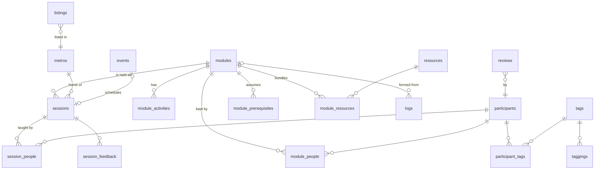

# Module catalog and knowledge base: schema draft

Draft of Nov 19, 2026, for Scaffolding and Front Door to work through together. Existing OLOS tables are a starting point and can change where the catalog needs them to.

Second pass, after the pod lead's decisions of Nov 19: federated data, regional modules proposed to national, module types, approval before publishing, the database as the source of truth, and one `tags` table shared with participants.

## What this draws on

- The PRD "A Bottom-Up Module Catalog for The Upskilling Labs" (Nov 14) and the steering committee member's notes in it.
- This prototype's module metadata (`modules/_template.md`) and situation logs (`situations/_template.md`).
- Front Door's scoping of who owns what, National, Regional or Both ([`participants-scoping.md`](https://github.com/wash-TheUpskillingLabs/c04-frontdoor/blob/main/research/participant-scope/participants-scoping.md)), its [`participants` data dictionary](https://github.com/wash-TheUpskillingLabs/c04-frontdoor/blob/main/research/participant-scope/participants-data-dictionary.md), and the OLOS schema diagrams in [`research/olos-schema/`](https://github.com/wash-TheUpskillingLabs/c04-frontdoor/tree/main/research/olos-schema) (OLOS at `ca543cc`).
- Front Door's [dimensions mind map](https://github.com/wash-TheUpskillingLabs/c04-frontdoor/blob/main/research/Upskilling_Labs_dimensions_mindmap_rough-draft.pdf) (rough draft): its names for activities, participant roles, knowledge capture and location.

## Decided (Nov 19)

- **Both means federated.** A record lives in one place, national or a region, and can also appear in others as a listing.
- **National by default, with locations listed.** A regional lab can build its own module and propose it for the national catalog, so labs don't end up with many near duplicates.
- **Draft, then approve, then publish.** Nothing is posted externally until someone approves it. The same rules apply to outside hosts.
- **An admin turns an emerging tag into a term.** A new tag starts as "Other" with the person's own words.
- **The database is the source of truth.** The role of the Markdown files is open (see the end).
- **Participants' interests and expertise use the same `tags` table** as modules. Open to rethinking later.

## Home and listings: how federated data works

Every record that can be shared has a **home** and can have **listings**.

- **Home** is where the record lives and who looks after it: national, or one region (an OLOS `metros` row, a local lab).
- **Listings** are the other places it appears. Each listing is one region, or national.

Example: a GitHub workshop module lives at national. A session of it is held in Washington, DC, so the session lives in DC and is listed on the DC page. A session in Baltimore lives in Baltimore, and can also be listed on the DC page, because it's close.

The same two columns go on every shareable table:

| Column | Type | Notes |
|---|---|---|
| `home_scope` | text: `national`, `regional` | |
| `home_metro_id` | integer → `metros`, nullable | Set when `home_scope` is `regional` |

Listings sit in one table for all record types:

| `listings` column | Type | Notes |
|---|---|---|
| `record_type` | text: `module`, `session`, `resource`, `log` | |
| `record_id` | integer | |
| `metro_id` | integer → `metros`, nullable | Empty means the national listing |
| `listed_by_participant_id` | integer → `participants` | |
| `created_at` | timestamptz | |

A record always appears at its home, so its home needs no listing row.

| Record | Usual home | Usually listed |
|---|---|---|
| Module | National. Regional if a lab built it and hasn't proposed it, or national hasn't accepted it yet | Nowhere else needed: a national module shows everywhere. A regional module shows in its own lab |
| Session | The region where it's held. National if it's virtual | Nearby labs (Baltimore on the DC page), and national through its module |
| Resource | National | Labs that want it on their page |
| Log | The region where it was captured | Wherever its permissions allow (see logs) |

## Module types and what a module holds

A module has a **type**. How it's delivered (in person or virtual) belongs to each session, because the same GitHub workshop can run in person in DC and online the next month. The industry term for that is **delivery mode** (or modality: instructor-led in person, or virtual instructor-led).

| `modules.type` | What it is |
|---|---|
| `training` | Teaches a skill. No required output |
| `workshop` | Hands-on. People leave with an output |
| `hackathon` | A work day to build fast with others |
| `sensemaking` | A work day to explore a problem and find its paradox |
| `talk` | A presentation (the mind map's "Talks") |

`sessions.delivery_mode`: `in-person`, `virtual`, `hybrid`.

Each module also has a **category**, saying what kind of knowledge it is:

| `modules.category` | What it covers | Example |
|---|---|---|
| `lab-practice` | How we work at the Labs | How to use GitHub here, how to use Slack here |
| `methodology` | A method or practice from outside | Design thinking, Dorst's frame creation, agile |
| `tool` | A service or tool, and how to connect to it | Connecting to the Labs' GitHub, Vercel, Supabase, Claude |
| `skill` | A general skill | Prompting, user interviews |

The same words are also tag kinds (below), so a module can be tagged with more than one.

A module holds **activities**: the exercises people go through, worked back from the learning outcome. They're their own table so they can be listed, timed and reused.

## The tables

`participants`, `metros`, `events` and `resources` already exist in OLOS. The rest are new.

### `modules`

Home: national by default (see "Home and listings").

| Column | Type | Must or Should | Notes |
|---|---|---|---|
| `id` | serial | | |
| `slug` | varchar(100), unique | Must | |
| `title` | varchar(255) | Must | |
| `summary` | text | Must | The short description, shown on the card |
| `description` | text | Must | The long description: the general-knowledge entry |
| `type` | text (see above) | Must | |
| `category` | text (see above) | Must | |
| `kind` | text: `upskilling`, `training` | Must | Upskilling is for learners. A training module is for the people who deliver modules |
| `output` | text | Must for workshops | What people leave with |
| `learning_outcome` | text | Must | What the learner can do afterward |
| `level` | `ai_experience_level` | Must | Reuses the participant enum: `new`, `consumer`, `builder`, `shipper` |
| `preparation` | text | Should | Pre-reading or setup to do first |
| `stages` | text[]: `prep`, `during`, `after` | Must | Before, during or after a cycle |
| `scales` | text[]: `1:1`, `1:few`, `1:cohort/public` | Must | |
| `delivered_by_role` | text | Must | The role that usually runs it. Who taught each session is in `session_people` |
| `facilitator_notes` | text | Should | How to run it: what to ask instead of telling |
| `timings` | text[]: `before-attempt`, `when-stuck`, `after` | Should | |
| `learner_stages` | text[]: `dependent`, `interested`, `involved`, `self-directed` | Should | |
| `support_fades` | text | Should | What gets withdrawn, and when |
| `time_estimate` | text | Should | |
| `private_way_in`, `way_out` | text | Must if `before-attempt` | Planned struggle can read as public failure (#5) |
| `validated_note` | text | | For the small top-down core, such as GitHub training. A sentence, not a "required" flag |
| `cycle_id` | integer → `cycles`, nullable | | Set for a cohort-specific module |
| `contributed_by_org` | text, nullable | | An anonymized label for an outside contributor |
| `thumbnail_url` | text | Should | The card's Open Graph image |
| `home_scope`, `home_metro_id` | | | See "Home and listings" |
| `national_status` | text: `not-proposed`, `proposed`, `accepted`, `declined` | | For a regional module proposed to the national catalog. Accepted moves its home to national |
| `status`, `version`, `published_version` | | | See "Approval and publishing" |
| `created_by_participant_id` | integer → `participants` | | |
| `created_at`, `updated_at`, `published_at` | timestamptz | | |

Nothing marks a module as required or graded. No completions, scores or credentials (PRD non-goals).

### `module_activities`

| Column | Type | Notes |
|---|---|---|
| `id` | serial | |
| `module_id` | integer → `modules` | |
| `position` | smallint | |
| `title` | text | |
| `instructions` | text | |
| `grouping` | text: `alone`, `pairs`, `group` | At least one alone and one with others is a good default (from a Poderator interview, #29) |
| `minutes` | smallint | |

### `module_people`

| Column | Type | Notes |
|---|---|---|
| `module_id` | integer → `modules` | |
| `participant_id` | integer → `participants` | |
| `role` | text: `maintainer`, `author`, `contributor` | The mind map's participant roles |
| `since`, `until` | timestamptz | |

Rule: a published module needs at least two current maintainers. Public pages show roles, and names only where the person's profile allows it.

### `module_prerequisites`

| Column | Type | Notes |
|---|---|---|
| `module_id` | integer → `modules` | |
| `requires_module_id` | integer → `modules`, nullable | |
| `requires_tag_id` | integer → `tags`, nullable | A skill or tool with no module yet. One of the two is set |

### `sessions`

A module held at a time and place. "Session" replaces the first draft's "offering."

| Column | Type | Notes |
|---|---|---|
| `id` | serial | |
| `module_id` | integer → `modules` | |
| `event_id` | integer → `events`, nullable | Date, venue and RSVPs come from the event once it's scheduled |
| `delivery_mode` | text: `in-person`, `virtual`, `hybrid` | |
| `home_scope`, `home_metro_id` | | The region where it's held. National if virtual |
| `host_org` | text, nullable | An outside host |
| `status` | text: `proposed`, `scheduled`, `held`, `cancelled` | Shown externally only after approval |
| `created_at`, `updated_at` | timestamptz | |

### `session_people`

| Column | Type | Notes |
|---|---|---|
| `session_id` | integer → `sessions` | |
| `participant_id` | integer → `participants` | |
| `role` | text: `teacher`, `co-teacher`, `host`, `mentor` | |

### `session_feedback`

Feedback on the session, not on the learner.

| Column | Type | Notes |
|---|---|---|
| `id` | serial | |
| `session_id` | integer → `sessions` | |
| `participant_id` | integer → `participants`, nullable | Empty for anonymous feedback |
| `useful` | smallint 1 to 5 | |
| `comment` | text | |
| `created_at` | timestamptz | |

### `resources` (existing)

OLOS's Library table. A module is a bundle of content, so its slides, guides, posts and recordings live here, and so does the rest of the knowledge base. Proposed changes:

- **File uploads.** `file_path` (Supabase Storage) next to the existing `url`, so a host can upload slides instead of linking them.
- **`content_type`** values to include `blog-post`, `guide`, `facilitation`, `recording`, `slide-deck`.
- **`audience`**: `learner` or `facilitator`.
- **Home and listings**, as above.
- **Tags** move from the jsonb `tags` column to `taggings`.
- **Approval**, the same as modules.

### `module_resources`

| Column | Type | Notes |
|---|---|---|
| `module_id` | integer → `modules` | |
| `resource_id` | integer → `resources` | |
| `purpose` | text: `learner`, `facilitator`, `preparation` | `preparation` is pre-reading |
| `position` | smallint | |

### `logs` (name to decide)

The light capture of help given in one situation: what the problem was and what worked. The mind map files this under "Knowledge capture & Reuse." The first draft called these situation logs; the name is still open.

| Column | Type | Notes |
|---|---|---|
| `id` | serial | |
| `problem` | text | A few lines |
| `what_worked` | text | A few lines. "Nothing did" is allowed |
| `logged_by_participant_id` | integer → `participants` | Never shown outside the permissions below |
| `logged_by_role` | text | What others see: "a mentor," "a Poderator" |
| `scale` | text: `1:1`, `1:few`, `1:cohort/public` | |
| `source` | text: `learning-session`, `cohort`, `event`, `escalation`, `front-door` | |
| `cycle_id` | integer → `cycles`, nullable | |
| `module_id` | integer → `modules`, nullable | Set when a module forms from it or it fits one |
| `home_scope`, `home_metro_id` | | Where it was captured |
| `visibility` | text: `private`, `regional`, `national` | Permission-based. `regional` means the regions in `listings`, one or more. `national` means every lab |
| `created_at` | timestamptz | |

Who can widen a log's visibility, and whether identifying details must be removed first, is open.

### `tags`, `taggings` and `participant_tags`

One taxonomy for modules, resources, logs and people.

| `tags` column | Type | Notes |
|---|---|---|
| `id` | serial | |
| `slug` | varchar(50), unique | |
| `label` | text | "GitHub," "Vibe coding," "Design thinking" |
| `kind` | text: `topic`, `lab-practice`, `methodology`, `tool`, `skill` | |
| `framework` | text, nullable | For methodology terms from Record #20's crosswalk: `dorst`, `double-diamond`, `ideo`, `agile`, `lean-startup` |
| `status` | text: `emerging`, `term`, `set-from-top` | |
| `proposed_by_participant_id` | integer → `participants`, nullable | |
| `approved_by_participant_id` | integer → `participants`, nullable | The admin who made it a term |
| `created_at`, `approved_at` | timestamptz | |

**Emerging tags.** When someone picks "Other" and writes their own, it becomes an `emerging` tag. It can be used straight away on their own record, and other people can pick it. An admin approves it as a `term`, merges it into an existing term, or declines it.

`taggings`: `tag_id`, `record_type` (`module`, `resource`, `log`, `session`), `record_id`.

`participant_tags`: `participant_id`, `tag_id`, `relation` (`interest`, `expertise`). This replaces the free-text `interest_areas` and `primary_expertise` that Front Door marked "New table." With the same tags on people and modules, the catalog can suggest modules from someone's interests, and find people with the expertise to teach or review a module.

## Approval and publishing

Every module, session and resource goes through the same states. Nothing is shown externally before approval.

| `status` | Who sees it |
|---|---|
| `draft` | The author and the people on it |
| `in-review` | Plus reviewers |
| `approved` | Ready to publish |
| `published` | Everyone its home and listings allow |
| `retired` | Kept for the record, no longer listed |

**Reviews.** One table for all record types:

| `reviews` column | Type | Notes |
|---|---|---|
| `id` | serial | |
| `record_type`, `record_id` | | |
| `version` | integer | The version reviewed |
| `reviewer_participant_id` | integer → `participants` | |
| `outcome` | text: `approved`, `changes-requested`, `declined` | |
| `checks` | jsonb | Which checks passed (below) |
| `notes` | text | |
| `reviewed_at` | timestamptz | |

**What a review checks (proposal).** From the PRD and the interviews:
- The learning outcome is stated, and the activities lead to it.
- The level and preparation are right for the audience.
- At least one activity to do alone and one with others.
- Facilitator notes say how to help without taking over.
- An attempt-first module has a private way in and a way out.
- No names, recordings of people, or identifying details. Outside content is anonymized where needed.
- Fit with the Labs (brand safety). Content is accurate and current.

**When it's reviewed again (proposal).** Editing a published module makes a new draft version. The published version stays up until the new one is approved, so nothing changes in front of learners without review. Beyond that, a maintainer confirms each module is current once a year, or a module is flagged when its feedback drops. How often is for the pod to set.

### An outside host shares their material

An outside host can upload their slides and fill in the metadata in one form. That creates a draft resource, a draft module (or a link to an existing one) and a proposed session, all of which go through approval.

| What the host enters | Stored as |
|---|---|
| The file (slides) | `resources.file_path` |
| Title | `modules.title` |
| Short description | `modules.summary` |
| Long description | `modules.description` |
| Type | `modules.type` |
| Topics: one or more, or "Other" with their own words | `taggings`. "Other" makes an emerging tag |
| Level | `modules.level` |
| Pre-reading or preparation | `modules.preparation`, and `module_resources` with purpose `preparation` |
| Where and when they're presenting | `sessions` and `events` |

## How people connect

| A person… | Through |
|---|---|
| keeps a module | `module_people` |
| reviews or approves something | `reviews`, `tags.approved_by_participant_id` |
| teaches or hosts a session | `session_people` |
| attends a session | the existing `event_rsvps`, through `sessions.event_id` |
| saves a module or resource | the existing `saved_items` |
| logs help they gave | `logs.logged_by_participant_id` |
| gives feedback on a session | `session_feedback` |
| sees local sessions | their `metro_id` (Front Door's dictionary: the authoritative local lab), plus listings |
| is matched to modules | `participant_tags` against module tags, and their level against `modules.level` |

`role_intents` (cycle, events, volunteer, mentor) could decide whether someone sees training modules by default.

## Changes this asks of OLOS

- **`events` has no region.** It needs `home_metro_id` and listings, so a session's event shows in the right labs.
- **`resources`** gets file uploads, an audience, home and listings, approval, and tags out of jsonb.
- **`participants.interest_areas` and `primary_expertise`** move to `participant_tags`.
- **`ai_experience_level` is defined but never set.** Modules use it as their level. Matching people to modules needs sign-up to ask it.
- **`saved_items` is keyed by slug.** Modules and resources need slugs that don't collide, or `saved_items` needs a type column.
- **Admin screens** for approving records and tags.

## Open questions

- [ ] What should situation logs be called? (See the note in the PRD discussion.)
- [ ] Who can widen a log's visibility, and must identifying details come out first?
- [ ] What does a review check, and how often is a module confirmed as current? Drafted above as a proposal.
- [ ] Can someone approve their own module, or must the reviewer be someone else? Drafted: someone else.
- [ ] Who decides that a session in one lab is listed on another lab's page: the host lab, the listing lab, or a "nearby" rule?
- [ ] When national accepts a regional module, does the lab stay its maintainer?
- [ ] What role do the Markdown files play now that the database is the source of truth? Options: drop them; keep them as seed data for OLOS; or export published modules to Markdown so they can be shared and sent upstream to OLOS as open source.
