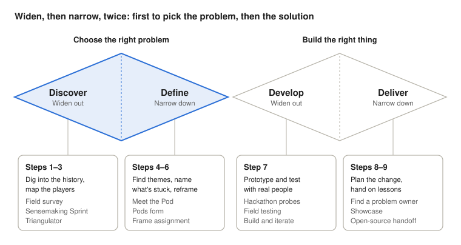

# From Problem to Frame: How the Build Cycle Works

Nov 21, 2026 · @Macon Morrison

Every Build Cycle asks you to choose the right problem before you build anything. This guide shows where you are in that process, what to aim for at each step, and how to tell when you're ready to move on.

## The shape of the cycle

The cycle follows the Double Diamond, a common design-thinking model. In each diamond you first widen out to explore, then narrow down to choose. The first diamond, choosing the right problem, is where most of the hard thinking happens and where pods most often get stuck.

**Halfway through, you switch diamonds.** At the hackathon your pod locks in its new views of the problem, and the first diamond is done: the problem is chosen, and the work turns to solutions. Bring your pod's findings with you: your project research can go deeper on your own users, but it should build on what the pod already learned. You'll also start hearing design-thinking words for ideas you already know: themes become *insights*, a new view becomes a *"How might we"* question, and your map of players becomes *stakeholders* and *personas*.

**Your pod is not your final team.** Pods work together on the problem through the hackathon. Afterwards, the pod splits into project teams of three to five people, each built around an idea that found real interest. Expect to work with a smaller group in the second half.

## Where am I, and what's next?

Find the step you're on, check its goal, and move on once the last column is true. You don't need to have read any theory to use this.

| Phase | Step | Your goal | Move on when… |
| --- | --- | --- | --- |
| Discover | 1. Dig into the history | Learn what's been tried before and why it didn't work | You can name at least three past attempts and why each fell short |
| Discover | 2. Map the players | Know who is already involved and how they work | You have a list of the main players and what each one does about the problem today |
| Discover | 3. Look further out | Find people and groups nobody has thought to involve | You've added at least two surprising players and what they care about |
| Define | 4. Find what people share | Discover the deeper values many players have in common | You have three to five named themes, each backed by real quotes or evidence |
| Define | 5. Name what's stuck | Say why this problem stays unsolved | You can state the deadlock in two or three sentences, and no single obvious fix resolves it |
| Define | 6. See it differently | Turn a theme into a new way of looking at the problem | You have several "what if we treated this as…" statements, and each sparks more than one idea |
| Develop | 7. Try it out | Turn your best new view into quick prototypes and test them with real people | Real people have used or reacted to something you made, and you know who would benefit |
| Deliver | 8. Plan the change | Work out who would need to do what differently for this to be adopted, and find someone who wants to own it | A real stakeholder has said "tell me more," and you know what they would need to change |
| Deliver | 9. Make it last | Build, show and hand on what you learned | Your work, evidence and lessons are written up in the project repository, so a future team can pick the project up |

It's normal to loop back. If a prototype in step 7 falls flat, return to step 6 and try another view. If every view feels weak, go back to step 4.

## Five ideas to hold onto

**1. Some problems resist the obvious fix.** They have no clear edges, many tangled parts, they keep changing, and they're shaped by people far away. Most Build Cycle topics are full of these. Pinning down "the problem" too early usually means pinning down the wrong one.

**2. Start with the situation, not the problem.** What you're handed is usually a symptom. Low voter turnout, rising clinic wait times or a stalled recycling scheme are each one visible piece of a bigger situation that includes people, history and constraints.

**3. Stuck problems have a deadlock at their core.** Two things are both true, and the usual fixes make one worse to improve the other. Naming that deadlock clearly is what lets you escape it.

**4. A new way of seeing brings new things to do.** One city treated its rowdy nightlife district as a crime problem for years. When designers treated it instead as a music festival that happens twice a week, the fixes became obvious: transport home, places to rest, toilets, friendly guides. A good new view gives you many ideas, not just one.

**5. New views come from what people share.** Before reframing, look for the values many different players have in common. Those shared values are what make a new idea land with partners, not just with your pod.

## Prompts and exercises

Use these in working sessions or on your own. Each step has a hands-on exercise and an AI prompt; do both, and check anything AI tells you against real people and sources.

**Step 1: Dig into the history**

- List every past attempt to fix this, in your area or a similar one. For each, write what it assumed the problem was.
- Write three "They will never…" statements about the main organisation involved.
- AI prompt: *"Here are my notes on past efforts to fix \[issue\]. For each one, what did it assume the problem was, and what other path could it have taken?"*

**Steps 2–3: Map the players, then look further out**

- Draw two rings. Inner ring: the people already trying to solve this. Outer ring: anyone who might matter, however unlikely. (In one city, a history museum helped calm a tense neighbourhood.)
- For each player, note what they value and what they trade in: money, attention, trust, status.
- AI prompt: *"Who else touches \[issue\] that a team like ours would usually overlook? Include businesses, cultural groups and informal networks."*

**Step 4: Find what people share**

- From your interviews, pull quotes where people talk about what they care about, not what they want fixed. Group them and name each group in one or two words, such as "sense of place" or "feeling heard."
- Keep the themes many players share. Those are where partnerships come from.
- AI prompt: *"Here are 30 quotes from people affected by \[issue\]. What deeper values or experiences recur across them? Name each in two words and show the quotes behind it."*

**Step 5: Name what's stuck**

- Write it in three parts: what is supposed to work and why it matters; how that same thing causes the problem; why the obvious fix would destroy what works.
- Or write it as a chain, the way Dorst does: *"Because… Because… Because…"*, each link leading to the next, until you end up back where you started. The worked example below shows one.
- Test it: if a single obvious fix resolves it, keep digging.
- AI prompt: *"Here is our deadlock. Argue each side as its strongest defender would. Which assumptions could be questioned?"*

**Step 6: See it differently**

- Complete: *"Everyone assumes this is a problem about \_\_\_. What if it's actually a problem about \_\_\_?"* Write at least five before choosing.
- Or use Dorst's own format: *"If the situation is approached as if it is \_\_\_, then \_\_\_."* Two of his examples:
  - *If the nightlife district is approached as if it is a music festival, then* it needs ways to get home, places to rest, toilets and friendly guides, not more police.
  - *If the Sydney Opera House podium is approached as if it is a problem of liveliness, then* it should host events that keep locals coming back, and the constant activity makes it harder for protesters to climb the sails unseen.
- Borrow from another world, like the nightlife-as-festival example. What would your problem look like as a gym membership, a neighbourhood potluck or a fantasy sports league?
- A good new view produces several ideas quickly. If it produces one, keep looking.

**Step 7: Try it out**

- For your top two views, list ten quick ideas each. Don't develop any yet; falling for one idea too early closes off better ones.
- Turn the most promising into quick probes: a landing page, a pitch email, a clickable mock-up.
- Put each in front of at least three real people and watch for "tell me more" or useful pushback.

**Step 8: Plan the change**

- For your strongest idea, list who would have to do something differently for it to be adopted, and what.
- Name one person or organisation who could own it. Ask them directly what would make them say yes.
- Drop ideas that need someone to change a lot for little in return. They won't happen.

## Worked example: the fitting rooms that became a catwalk

A clothing department store asked designers to stop theft in its fitting rooms. Here is how the steps led somewhere nobody expected. The case is from Dorst's *Frame Innovation*, chapter 4.

**1. Dig into the history.** Cameras weren't allowed in fitting rooms for privacy reasons, so tags were the only defence, and professional thieves tore them off and hid them. The store moved fitting rooms away from the exits, cut their number and size, and removed shelves, chairs and mirrors. A quick check still turned up dozens of tags hidden in ceilings and partitions.

**2. Map the players.** Police, store designers and security firms had shaped every fix so far. The player nobody had asked was the honest customer, now squeezed into cramped grey cubicles with nowhere to hang their own clothes.

**3. Look further out.** Clothes are how people express who they are, so friends and family shape what people buy. Online shopping was hitting sales, and staff were chasing away people they suspected of browsing, which made the store even less appealing. That raised a bigger, open question: what is a physical store for now?

**4. Find what people share.** Two themes stood out:

- Choosing clothes is social and sensitive, yet the store made people do it alone in an isolated booth.
- A store's value is the live experience, the one thing online shopping can't offer.

**5. Name what's stuck.** As a "because" chain:

- Because fitting rooms give customers privacy and a good shopping experience, they make good hiding places.
- Because they're good hiding places, they become where theft happens.
- Because theft happens there, the store adds measures that make them less comfortable.
- Because they're less comfortable, they no longer give a good shopping experience.

The chain ends where it started, so every anti-theft fix undermines the reason fitting rooms exist.

**6. See it differently.** Combining the two themes gives the new view, written two ways:

- Dorst's format: *if the store's declining sales are approached as a problem of creating a more fulfilling social shopping experience, then the fitting rooms should become a catwalk.*
- The Labs' format: *"Everyone assumes this is a problem about theft. What if it's actually about making shopping social again?"*

**7. Try it out.** A catwalk in the middle of the store, with cameras so shoppers can post photos and let friends vote on what to buy. A public, social space is also a poor place to steal.

**8. Plan the change.** Dorst notes this isn't small: the store would have to rethink its logistics and supply chain, and give fitting rooms far more floor space.

Notice that the new view came from steps 3 and 4, not from the original request about theft. That is why the middle steps are worth the time.

## Traps to watch for

| Trap | How it shows up | What to do instead |
| --- | --- | --- |
| Going it alone | One person or group "owns" the problem and treats others as interference | Bring in the players from your map early |
| Researching forever | Endless reading before anyone tests anything | Set a deadline for new views, then learn by sketching ideas |
| The usual fix | Reaching straight for a website, an app or a dashboard | Ask what your new view implies before choosing a format |
| "Of course…" | "Of course people just need better information" | Treat every "of course" as an assumption to test |
| "That's not what we do" | Dismissing a direction because it feels unfamiliar | If a theme points somewhere new, follow it |
| Skipping the middle | Jumping from the deadlock straight to a solution | Spend at least one session on steps 2–4 |
| A new view that isn't new | It just restates the symptom ("low turnout is a turnout problem") | Borrow a comparison from a completely different world |
| Trusting AI blindly | Accepting AI-suggested themes or contacts without checking | Trace every theme to real quotes and every contact to a real person |

## Want to go deeper?

The Discover and Define steps are adapted from Kees Dorst's *Frame Innovation*. You'll hear facilitators and the Triangulator use his words. The last column gives the names employers and other teams use for similar work, so you can describe what you did in a job interview.

| Our step | Dorst's term | Similar methods you may know |
| --- | --- | --- |
| Dig into the history | Archaeology | Desk research, review of past attempts |
| Map the players | Context | Stakeholder mapping, interviews, observation |
| Look further out | Field | Ecosystem or landscape mapping |
| Find what people share | Themes | Synthesis, affinity mapping, insights |
| Name what's stuck | Paradox | Problem statement, problem analysis |
| See it differently | Frames | Reframing, "How might we" questions |
| Try it out | Futures | Rapid prototyping, user testing, lean startup |
| Plan the change | Transformation | Implementation planning, change management |
| Make it last | Integration | Lessons learned, retrospectives |

These are related, not identical: Dorst spends more time on the problem than most design-thinking models do.

**Read and try**

- Kees Dorst, [*Frame Innovation: Create New Thinking by Design*](https://drive.google.com/file/d/1wYSUO7iVzHK23Zctpy4IBNjusCJljXkL/view?usp=drivesdk) (MIT Press, 2015), on a shared Drive that not everyone can open. Chapters 1–4 are enough; chapter 4 walks through the steps with real cases.
- [The Triangulator](https://theupskillinglabs.github.io/triangles/), the Labs' tool for steps 1–5. It turns field evidence into themes, a problem situation and a deadlock.

**Past workshops that help**

- Steps 1 and 5: Ask Better Questions: AI-Powered Problem Framing (Rachael Wooden)
- Step 2: Design Thinking / Intro to UX Design (Eric Meniefield)
- Step 4: Design Thinking (Evan Katz)
- Step 6: How Might We (Helen Glover)
- Step 7: From Problem to Prototype (Victoria Harrison); Vibe Coding (Lilah Schaeffer, AJ Bubb)
- Step 8: Customer Discovery (Randall Noval); Building Out Loud (Javi Calderon, Suzie Zhang)
- Step 9: GitHub 2.0: The Handoff (Aaron McKeever); Storytelling (John Cornwell)
