# Players: context and field

Who is in this problem: *how much structure does a learner need, when, and
from whom?* Roles and organizations only, never named individuals.

- **Context** (inner circle): the players at The Labs who affect this
  problem today, or who would have to be part of any solution.
- **Field** (outer circle): everyone around the problem who isn't in the
  room.

First draft, Nov 24, 2026. The inner circle comes from the README's "Who
seems to be involved"; the field comes from the
[Code for America Brigades case](case-code-for-america-brigades.md).
Entries marked **(to confirm)** appear in a source but the pod hasn't yet
agreed they belong on the map. Fields marked *Open* are for the pod to
fill from its own judgment and interviews.

```mermaid
flowchart TB
  subgraph FIELD["Field (outer circle)"]
    direction TB
    CFA["Code for America (national org)"]
    CTDC["Civic Tech DC, formerly Code for DC"]
    BV["Brigade volunteers"]
    BF["Brigade funders"]
    GOV["Local government partners (to confirm)"]
    WDC["Workforce development centers (to confirm)"]
    GOVF["State and city government as AI training funders"]
    AIF["AI companies as funders"]
    subgraph CONTEXT["Context (inner circle): The Labs"]
      direction TB
      UP["Upskillers (participants)"]
      VOL["Volunteers"]
      MEN["Mentors"]
      WL["Workshop leaders"]
      FAC["Facilitators"]
      ORG["Organizers"]
      MAIN["Maintainers of ongoing projects"]
    end
  end
```

## Context (inner circle)

Listed in the README. "What they bring," "what they want" and "how they see
the problem" are open until the pod fills them from its interviews.

| Player and type | Who they are, where people meet them | What they've tried | Evidence so far |
|---|---|---|---|
| Upskillers (people) | Participants in a Build Cycle. Separate from volunteers at The Labs (per the builder) | *Open* | Interviews [#16](interview-past-participant-2026-11-07.md), [#23](interview-c03-c04-participant-2026-11-09.md), the [maintainer self-report](interview-maintainer-self-report.md) |
| Volunteers (people) | Separate from participants at The Labs (per the builder). Which roles count as volunteers is *Open* | *Open* | Interview [#29](interview-past-participant-poderator-2026-11-13.md) (a Cycle 2 Poderator); see "What volunteers want" below |
| Mentors (people) | *Open* | *Open* | *Open* |
| Workshop leaders (people) | *Open* | *Open* | *Open* |
| Facilitators (people) | Includes Poderators, per the interviews | *Open* | Interview [#29](interview-past-participant-poderator-2026-11-13.md) |
| Organizers (people) | Run the Cycle; includes the steering committee | *Open* | Interviews [#25](interview-steering-committee-member-2026-11-05.md), [#28](interview-organizer-2026-11-09.md); Record #15 |
| Maintainers of ongoing projects (people) | *Open* | *Open* | *Open* |

### What volunteers want (first answer)

**The builder's read:** "Volunteers want a clear role definition and
permission to intervene to help get teams unstuck in cases where the team
is not making progress (as was the case with one team in Cycle 03)."

Based on a Cycle 2 Poderator's account
([#29](interview-past-participant-poderator-2026-11-13.md)):
- "how much I'm, quote unquote, allowed? Encouraged? to... suggest?"
- "very at sea around how much we should suggest, or had permission to
  suggest"
- "The definition around that role. There was so little of it."
- Two other Poderators, secondhand: "a pretty significant gap in the
  structure of the cycle and therefore... how they felt comfortable
  intervening."

Possible reason, as he reports it: an organizer's position, "The more
autonomy, the better. This should really be about discovery," which
Poderators read as "less intervention was more."

Source to add: the Cycle 3 team that was not making progress (#29 covers
Cycle 2; the Poderator did not serve in Cycle 3).

For each, the pod still needs the full seven answers from the README:
player and type; who they are and where people meet them; context or field;
what they bring (community capitals); what they want; what they've tried;
how they see the problem.

## Field (outer circle)

### Code for America (organization)

1. **Player and type:** Code for America, national nonprofit (institution).
2. **Who they are:** Works on making government services work well. Ran
   the Brigade network of local volunteer chapters from 2012 and ended it
   in 2023 ([case](case-code-for-america-brigades.md)).
3. **Context or field:** Field.
4. **What they bring:** *Open.* From the case: fiscal sponsorship for
   chapters, a national brand, national events.
5. **What they want:** *Open.* In its own words (2022): "breaking down
   barriers to make government work well for everyone" and "scaling local
   knowledge to make a national impact"
   ([A New Vision](https://codeforamerica.org/news/a-new-vision-for-the-code-for-america-network/)).
6. **What they've tried:** A national network of volunteer chapters; a
   2022 redesign of the network; ending the program in 2023 with a promised
   10-month transition ([case](case-code-for-america-brigades.md)).
7. **How they see the problem:** *Open.*

### Civic Tech DC, formerly Code for DC (organization)

1. **Player and type:** Volunteer-led civic tech nonprofit in the DC area
   (institution).
2. **Who they are:** A Brigade from 2012; went on hiatus in Jun 2022;
   restarted by volunteers in Jan 2023; renamed Oct 2023
   ([Civic Tech DC history](https://civictechdc.netlify.app/history/)).
   In 2020 its fiscal sponsor was a nonprofit set up by former members, and
   it was funded entirely by donations (Brigade 2.0 video, 1:13:18).
3. **Context or field:** Field. The closest outside group to The Labs, in
   the same region.
4. **What they bring:** *Open.*
5. **What they want:** *Open.*
6. **What they've tried:** *Open* beyond the history above.
7. **How they see the problem:** *Open.* In 2020 a volunteer named
   burnout, "people disappearing," and funding as challenges (1:13:18).

### Brigade volunteers (people)

1. **Player and type:** Volunteers in Code for America Brigade chapters
   (people). At the Brigades, volunteers and participants appear to be
   the same people. At The Labs they are separate roles (per the builder).
2. **Who they are:** At Hack for LA, ages 15 to 72; long-term volunteers
   were mostly retired software professionals (56:27; 1:00:43).
3. **Context or field:** Field.
4. **What they bring:** *Open.*
5. **What they want:** Per one chapter captain: "becoming better at their
   craft, becoming more employable, giving back to the community, being
   part of the community" (55:14). Most "volunteer to solve specific
   problems, not build an organization for no pay" (54:42). One leader's
   view, not volunteers' own words.
6. **What they've tried:** *Open.*
7. **How they see the problem:** *Open.*

### Brigade funders (institutions)

1. **Player and type:** Foundations and public bodies that funded Brigades
   or the network (institutions).
2. **Who they are:** Named in the 2020 session: the Knight Foundation,
   which a chapter director said funded Code for America's network team
   (42:04); the Alfred P. Sloan Foundation (BetaNYC core operations,
   33:35); the Mozilla Foundation (a Hack for LA project, 53:16); a county
   supervisor's office (53:16).
3. **Context or field:** Field.
4. **What they bring:** Financial capital.
5. **What they want:** *Open.*
6. **What they've tried:** *Open.*
7. **How they see the problem:** *Open.*

### Local government partners (institutions) (to confirm)

1. **Player and type:** City and county offices that worked with Brigades
   (institutions).
2. **Who they are:** For example, a borough president's office (BetaNYC),
   LA's transportation department and city attorney's office (Hack for LA,
   56:53). A senior city IT official described "revolving door volunteers"
   (57:52).
3. **Context or field:** Field.
4. to 7. *Open.*

### Workforce development centers (institutions) (to confirm)

1. **Player and type:** Public workforce centers (institutions).
2. **Who they are:** Hack for LA's captain said LA's centers "work well if
   you're a warehouse worker; they don't work well if you're a tech worker"
   (58:47).
3. **Context or field:** Field.
4. to 7. *Open.*

### State and city government as funders of AI workforce training (institutions)

1. **Player and type:** State and city government (institutions).
2. **Who they are:** In New York, the state (including Empire State
   Development), the Queens Borough President's Office and the City
   Council put $10 million of public investment behind Pursuit's AI Jobs
   Institute (announced Oct 22, 2026). The City Council also supported the
   small business Demo Day ([Pursuit case draft](case-pursuit.md)).
3. **Context or field:** Field.
4. **What they bring:** Financial and political capital.
5. **What they want:** *Open.* One city council member: "AI should not be
   another dividing line between the companies that can afford to innovate
   and everyone else." Another called for funding beyond pilots and for
   tracking whether the tools help businesses grow.
6. **What they've tried:** Funding an AI training hub to serve up to
   40,000 New Yorkers by 2032.
7. **How they see the problem:** *Open.*

### AI companies as funders (institutions)

1. **Player and type:** AI and technology companies funding AI training
   (institutions).
2. **Who they are:** For Pursuit: Google.org, OpenAI and Anthropic among
   the AI Jobs Institute's partners; Google and Amazon behind the small
   business pilots. For Senior Planet (AARP): OpenAI as partner on an AI
   skills workshop series ([case leads](case-leads.md)).
3. **Context or field:** Field.
4. **What they bring:** Financial capital; access to AI tools.
5. **What they want:** *Open.*
6. **What they've tried:** *Open.*
7. **How they see the problem:** *Open.*

## Not yet on the map

- **Employers and HR leaders**, and **workers worried about AI**, from
  [Record #36](https://github.com/wash-TheUpskillingLabs/c04-scaffolding/issues/36).
  The pod hasn't decided whether they belong.
- Players from other leads: YouthBuild, Recurse Center, Fab Academy, Civic
  Hall.
