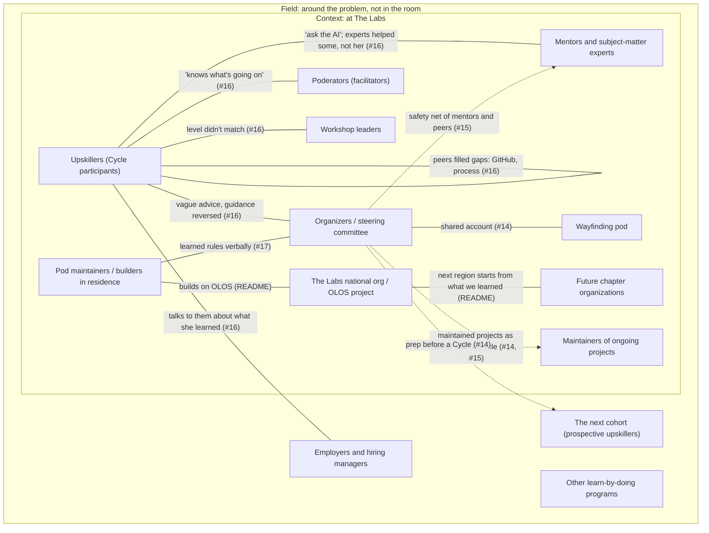

# Players: context and field

**Last updated:** Nov 8, 2026

**What changed (Nov 8):** Pod decisions: subject-matter experts merged into **Mentors and subject-matter experts**; facilitators merged into **Poderators (facilitators)**; the national organization and OLOS confirmed as context; **future chapter organizations** added as context.

**Nov 7:** First draft. Players come from the README's sensemaking-day list ("Who seems to be involved"), the interview with a past participant ([#16](https://github.com/wash-TheUpskillingLabs/c04-scaffolding/issues/16), its "What research is still needed" list, and its comments), the maintainer's confusion log ([#17](https://github.com/wash-TheUpskillingLabs/c04-scaffolding/issues/17)), and the steering committee's records ([#3](https://github.com/wash-TheUpskillingLabs/c04-scaffolding/issues/3) to [#15](https://github.com/wash-TheUpskillingLabs/c04-scaffolding/issues/15)). Every field is cited or marked **unknown**. Influence ratings are left for the pod to decide. They're marked **pod to decide**.

**How to read this.** Everything here comes from **one interview** and **one organizer's account**. Most of what we know about each player comes from someone else describing them. Where a player hasn't spoken for themselves yet, the entry says so. That's who to talk to next.

## Map

Solid lines: a connection someone described in the research. Dashed lines: a connection the organizers *intend* ([#15](https://github.com/wash-TheUpskillingLabs/c04-scaffolding/issues/15)) but nobody has described happening yet. Players with no lines have no evidence of a connection yet.

## Context: at The Labs

### Upskillers (Cycle participants) (person)
1. **Player and type.** People who take part in a Build Cycle (person).
2. **Who they are, where you meet them.** Our only firsthand source is one past participant from the pilot (Health Care) and Energy & Climate Cycles. She was returning to work after a long career break and has a research and scientific-programming background ([#16](https://github.com/wash-TheUpskillingLabs/c04-scaffolding/issues/16)). A pod maintainer was a Civics & Elections participant ([#17](https://github.com/wash-TheUpskillingLabs/c04-scaffolding/issues/17)). Where they're met: Slack, pod meetings, in-person sessions in DC ([#16](https://github.com/wash-TheUpskillingLabs/c04-scaffolding/issues/16)).
3. **Context or field?** Context.
4. **What they bring.** Human capital: prior skills and research habits (one participant, [#16](https://github.com/wash-TheUpskillingLabs/c04-scaffolding/issues/16)). Social capital: peers teaching peers (GitHub, the Cycle process) ([#16](https://github.com/wash-TheUpskillingLabs/c04-scaffolding/issues/16)). How much: unknown.
5. **What they want.** Two people's words so far:
   - Past participant: "my main aim is to actually find a job and find my purpose. I did not reach this aim." / "What the upskilling lab is promising is something very specifically AI. At least that was my perception." / "these are the tools you can use, and these are the expectations... this week is going to be for this purpose." / (Slack) "a learner might complain about being micromanaged but never structure." ([#16](https://github.com/wash-TheUpskillingLabs/c04-scaffolding/issues/16) and its comment)
   - Interviewer, as a past participant: "I specifically wanted to learn to vibe code." ([#16](https://github.com/wash-TheUpskillingLabs/c04-scaffolding/issues/16), "My own experience")
   - She said "not everyone is there to have their own startup." That's her read of other people's goals, so it's hearsay about them.
6. **What they've tried.** Taught themselves: "I just decided like, okay, you know what, this is what I want to learn." Started the team GitHub repo and explained the process to others: "even though that's not, you know, my job." Posted research into a silent Slack to get others going ([#16](https://github.com/wash-TheUpskillingLabs/c04-scaffolding/issues/16)). How it went: she learned AI skills ("more confident using AI") but would not do another Cycle ([#16](https://github.com/wash-TheUpskillingLabs/c04-scaffolding/issues/16)).
7. **How they see the problem.** One participant: the problem is unclear purpose, not too much structure. "Maybe the lab needs to make it clear in their own head what the purpose is" ([#16](https://github.com/wash-TheUpskillingLabs/c04-scaffolding/issues/16)). She called her own case "an exception."
- **Influence over this problem:** pod to decide.
- **Connected to:** organizers, mentors and subject-matter experts, poderators, workshop leaders, each other, employers ([#16](https://github.com/wash-TheUpskillingLabs/c04-scaffolding/issues/16)).

### Organizers / steering committee (group)
1. **Player and type.** The people who design and run Cycles (group).
2. **Who they are, where you meet them.** A steering committee member who has organized past Cycles gave the account in [#15](https://github.com/wash-TheUpskillingLabs/c04-scaffolding/issues/15). The committee logged [#3](https://github.com/wash-TheUpskillingLabs/c04-scaffolding/issues/3) to [#15](https://github.com/wash-TheUpskillingLabs/c04-scaffolding/issues/15). Participants meet them in organizer meetings ([#16](https://github.com/wash-TheUpskillingLabs/c04-scaffolding/issues/16)) and in-person sessions ([#17](https://github.com/wash-TheUpskillingLabs/c04-scaffolding/issues/17)).
3. **Context or field?** Context.
4. **What they bring.** Unknown. They set the Cycle's structure, but no source says what resources they have. #15 says the aims are ones they "haven't had the time or resources to achieve."
5. **What they want.** One organizer's account, in the record's words ([#15](https://github.com/wash-TheUpskillingLabs/c04-scaffolding/issues/15), [#14](https://github.com/wash-TheUpskillingLabs/c04-scaffolding/issues/14)): "A flow of training modules, then a drop, then a safety net." / "An open contribution model with disciplined, high-quality maintainers." / "The Cycle shouldn't be most people's way in." / "The Cycle isn't the destination either." These are written up by the committee, not verbatim speech.
6. **What they've tried.** From the participant's side only (hearsay about organizers): told pods they were "narrowing down too quickly," then gave them one week to narrow. Pushed "use AI for everything... And then suddenly they switched." "Each cycle, they change things" ([#16](https://github.com/wash-TheUpskillingLabs/c04-scaffolding/issues/16)). Organizers' own account of what they tried: unknown.
7. **How they see the problem.** Per #15: a problem of getting people over a confidence threshold, then catching them. Per the C04 invite: "People handed a syllabus never build the judgment the Cycle is for" ([#16](https://github.com/wash-TheUpskillingLabs/c04-scaffolding/issues/16)).
- **Influence over this problem:** pod to decide.
- **Connected to:** upskillers, pod maintainers, Wayfinding. Intended: mentors, maintainers of ongoing projects, the next cohort.

### Mentors and subject-matter experts (person)
1. **Player and type.** Volunteer mentors and subject-matter experts in a Cycle (person). One player in this model (pod decision, Nov 8).
2. **Who they are, where you meet them.** Mentors are volunteers, "taking... out of his own time" (participant's words, [#16](https://github.com/wash-TheUpskillingLabs/c04-scaffolding/issues/16)). Where they're met: unknown.
3. **Context or field?** Context.
4. **What they bring.** Human capital (expertise) and time. How much: unknown.
5. **What they want.** **Unknown.** No mentor or expert has been interviewed.
6. **What they've tried.** Hearsay from one participant: didn't answer questions on security technology and legal issues, and later said "ask the AI" ([#16](https://github.com/wash-TheUpskillingLabs/c04-scaffolding/issues/16)). On experts generally: "I'm sure a lot of people benefited from that. I didn't." She overheard that "some people did find it helpful" (hearsay) ([#16](https://github.com/wash-TheUpskillingLabs/c04-scaffolding/issues/16)). She wanted experts for "a very specific question that I cannot find by myself... something that is based on experience" (that's her want, not theirs).
7. **How they see the problem.** Unknown.
- **Influence over this problem:** pod to decide.
- **Connected to:** upskillers ([#16](https://github.com/wash-TheUpskillingLabs/c04-scaffolding/issues/16)). Intended: the "safety net" ([#15](https://github.com/wash-TheUpskillingLabs/c04-scaffolding/issues/15)).

### Poderators (facilitators) (person)
1. **Player and type.** People who run or facilitate a pod (person). The README's sensemaking list called them facilitators; same player (pod decision, Nov 8).
2. **Who they are, where you meet them.** Unknown beyond the name.
3. **Context or field?** Context.
4. **What they bring.** Unknown.
5. **What they want.** **Unknown.** None interviewed.
6. **What they've tried.** Unknown.
7. **How they see the problem.** Unknown. The participant valued "somebody who knows what's going on behind the scenes to be able to clarify to the participants" ([#16](https://github.com/wash-TheUpskillingLabs/c04-scaffolding/issues/16)). That's her view of them, not theirs.
- **Influence over this problem:** pod to decide.
- **Connected to:** upskillers ([#16](https://github.com/wash-TheUpskillingLabs/c04-scaffolding/issues/16)).

### Workshop leaders (person)
1. **Player and type.** People who teach workshops (person).
2. **Who they are, where you meet them.** Workshops in person in DC and virtually ([#16](https://github.com/wash-TheUpskillingLabs/c04-scaffolding/issues/16)). Design thinking was taught at the hackathon on the Newcomer track ([#17](https://github.com/wash-TheUpskillingLabs/c04-scaffolding/issues/17)).
3. **Context or field?** Context.
4. **What they bring.** Human capital. How much: unknown.
5. **What they want.** **Unknown.** None interviewed.
6. **What they've tried.** An agentic AI workshop tied to one vendor's tool that assumed participants knew what an agent was ([#16](https://github.com/wash-TheUpskillingLabs/c04-scaffolding/issues/16)). How they choose a level: unknown.
7. **How they see the problem.** Unknown.
- **Influence over this problem:** pod to decide.
- **Connected to:** upskillers ([#16](https://github.com/wash-TheUpskillingLabs/c04-scaffolding/issues/16)).

### Pod maintainers / builders in residence (person)
1. **Player and type.** C04 builders who lead the pod's research and projects (person). That's us.
2. **Who they are, where you meet them.** This repo, pod meetings. One was a Civics & Elections participant ([#17](https://github.com/wash-TheUpskillingLabs/c04-scaffolding/issues/17)).
3. **Context or field?** Context.
4. **What they bring.** Unknown. Pod to fill in.
5. **What they want.** One maintainer, as a past participant: "I specifically wanted to learn to vibe code" ([#16](https://github.com/wash-TheUpskillingLabs/c04-scaffolding/issues/16)). Others: unknown.
6. **What they've tried.** A running log of what confused them ([#17](https://github.com/wash-TheUpskillingLabs/c04-scaffolding/issues/17)).
7. **How they see the problem.** Unknown as a group. The #17 log points to things being hard to find and terms going undefined.
- **Influence over this problem:** pod to decide.
- **Connected to:** organizers ([#17](https://github.com/wash-TheUpskillingLabs/c04-scaffolding/issues/17)), OLOS (README).

### Maintainers of ongoing projects (person)
1. **Player and type.** People who keep projects going after a Cycle (person).
2. **Who they are, where you meet them.** Unknown. #14 describes maintained projects as a possible "longer-term experience."
3. **Context or field?** Context.
4. to 7. **Unknown.** No one in this role has been interviewed. The organizers want "disciplined, high-quality maintainers" ([#15](https://github.com/wash-TheUpskillingLabs/c04-scaffolding/issues/15)). That's what the organizers want, not what maintainers want.
- **Influence over this problem:** pod to decide.
- **Connected to:** intended by organizers ([#14](https://github.com/wash-TheUpskillingLabs/c04-scaffolding/issues/14), [#15](https://github.com/wash-TheUpskillingLabs/c04-scaffolding/issues/15)).

### Wayfinding pod (group)
1. **Player and type.** The C04 pod that owns the thresholds between the parts of The Labs (group) (README).
2. **Who they are, where you meet them.** [c04-wayfinding](https://github.com/wash-TheUpskillingLabs/c04-wayfinding). We read each other's repos weekly (README).
3. **Context or field?** Context.
4. to 7. **Unknown** from this repo. Their own repo may have more.
- **Influence over this problem:** pod to decide.
- **Connected to:** organizers ([#14](https://github.com/wash-TheUpskillingLabs/c04-scaffolding/issues/14)).

### The Labs national organization / OLOS project (institution)
1. **Player and type.** Runs the Upskilling App at theupskillinglabs.org and the main OLOS project (institution) (README).
2. **Who they are, where you meet them.** The dashboard and public homepage ([#17](https://github.com/wash-TheUpskillingLabs/c04-scaffolding/issues/17)). The OLOS repo (README).
3. **Context or field?** Context (pod decision, Nov 8).
4. **What they bring.** Built capital: the platform (README).
5. to 7. **Unknown.**
- **Influence over this problem:** pod to decide.
- **Connected to:** pod maintainers (README).

### Future chapter organizations (institution)
1. **Player and type.** Regional Labs that will start from OLOS after Greater Washington (institution).
2. **Who they are, where you meet them.** Unknown. The README says changes go "back to the main OLOS project as a pull request, so the next region starts from what we learned."
3. **Context or field?** Context (pod decision, Nov 8).
4. to 7. **Unknown.** None exist to talk to yet, as far as the research shows.
- **Influence over this problem:** pod to decide.
- **Connected to:** the national organization / OLOS (README).

## Field: around the problem, not in the room

### Employers and hiring managers (institution)
1. **Player and type.** Employers (institution).
2. **Who they are, where you meet them.** Unknown. The participant described what she learned "to a hiring manager" ([#16](https://github.com/wash-TheUpskillingLabs/c04-scaffolding/issues/16)).
3. **Context or field?** Field.
4. **What they bring.** Unknown. Jobs are what at least one participant is after ([#16](https://github.com/wash-TheUpskillingLabs/c04-scaffolding/issues/16)).
5. **What they want.** **Unknown.** None interviewed. #16 asks "which skills and labels they recognize."
6. to 7. **Unknown.**
- **Influence over this problem:** pod to decide.
- **Connected to:** upskillers ([#16](https://github.com/wash-TheUpskillingLabs/c04-scaffolding/issues/16)).

### Other learn-by-doing programs (institution)
1. **Player and type.** Apprenticeships, Cooperative Extension, coding bootcamps, self-directed schools (institution) (README, "Where to look first").
2. to 7. **Unknown.** No case studies logged yet.
- **Influence over this problem:** pod to decide.
- **Connected to:** unknown.

### The next cohort (prospective upskillers) (person)
1. **Player and type.** People who haven't joined a Cycle yet (person) (README field list).
2. **Who they are.** Unknown.
3. **Context or field?** Field.
4. to 7. **Unknown.** Organizers want them to get "prep before a Cycle" ([#14](https://github.com/wash-TheUpskillingLabs/c04-scaffolding/issues/14)). That's the organizers' want, not theirs.
- **Influence over this problem:** pod to decide.
- **Connected to:** intended by organizers ([#14](https://github.com/wash-TheUpskillingLabs/c04-scaffolding/issues/14)).

## Named, but no evidence yet

The README lists these as typical field players. Nothing in the research mentions them for this problem yet. They stay off the map until someone finds a reason.

- Libraries
- Funders
- Agencies
- Universities
- AI tool vendors (a workshop was tied to Copilot, and NotebookLM was recommended ([#16](https://github.com/wash-TheUpskillingLabs/c04-scaffolding/issues/16)), but neither vendor is in the room or shaping it, as far as we know)
